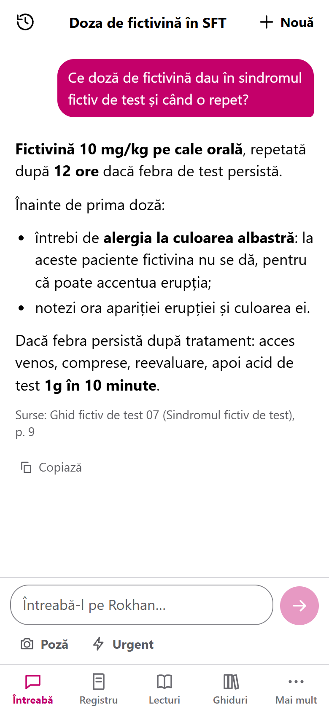
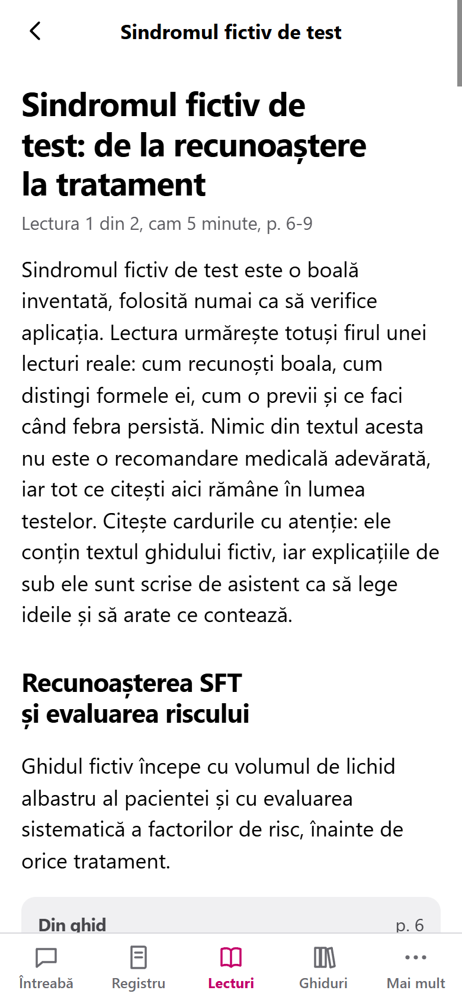
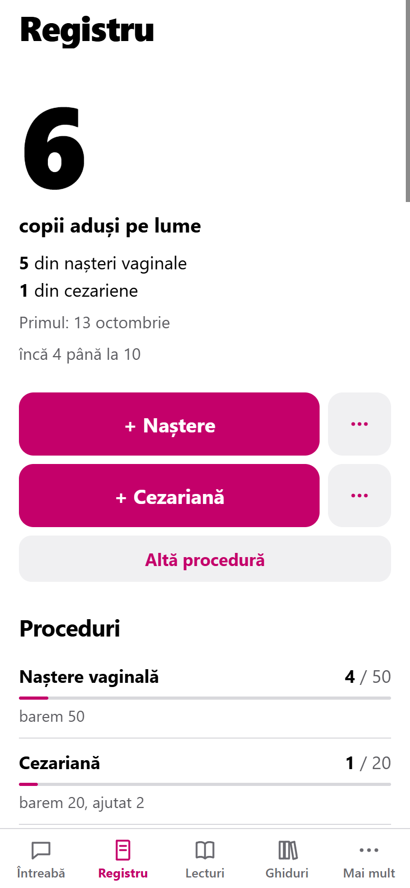
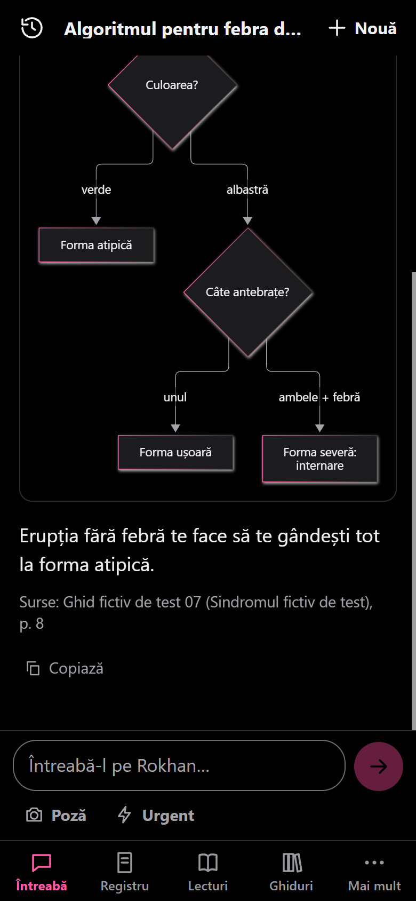
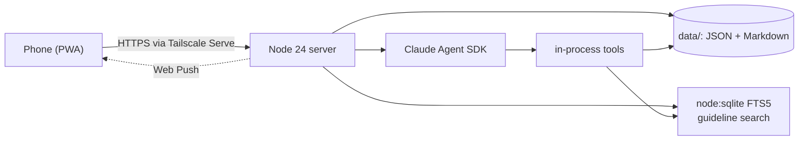

# Rokhan: a clinical study assistant for one OB-GYN resident

Rokhan is a phone-first web app for a first-year obstetrics and gynecology resident in Romania. It answers clinical
questions from the Romanian (SOGR) guidelines with page-level sources, keeps her procedure logbook against the residency
targets, turns the guidelines into short daily lessons with a quiz and spaced review, and remembers what she is studying.
It replaced a Telegram bot she had been using, because a chat window could not hold a logbook, a guideline library or
lessons. It was built for, and used by, one person; the code and the demo here contain no personal data and no
guideline text (the guideline in the tests and the demo is invented).

<p>
  
  
  
  
</p>

All screenshots are from `npm run demo` with invented data. More in [`docs/screenshots/`](docs/screenshots/).

## Features

- **Întreabă (Ask)**: chat with Rokhan, the assistant (a Darkspear shadow hunter persona). It searches the guideline
  library first, reads the exact lines, and ends every answer with its sources. An "urgent" switch asks for the steps
  only. Photos (a lab result, a CTG) can be attached. Diagrams render from Mermaid.
- **Registru (Logbook)**: procedures by role (performed, assisted, observed) against the residency targets, a
  babies-delivered counter, one-tap entries that also work offline, and logging by chat ("notează o cezariană").
- **Lecturi (Lessons)**: about seven minutes a day cut from one guideline, with the guideline's own text as cards, a
  three-question quiz, and a spaced-review session of past quiz questions.
- **Ghiduri (Guidelines)**: full-text search across the library (diacritics-insensitive), tables of contents with pages,
  and the source line ranges the assistant cited.
- **Mai mult (More)**: the memory pages the assistant keeps about her studies (editable), a gestational-age calculator,
  three visual looks with light and dark themes, larger text, and a daily lesson notification.

## Architecture

- **Node 24, no framework.** `node:http`, a small router, atomic JSON and Markdown files in one data folder.
- **`node:sqlite` with FTS5** for the guideline search, built in memory from the Markdown library.
- **Claude Agent SDK, locked down**: no settings, skills, plugins or hooks; only web search and the app's own in-process
  tools (library, logbook, memory, lessons, a guarded URL fetcher). The SDK's `init` message is checked on every turn.
- **A PWA without a build step**: Preact and htm as vendored ES modules, a service worker, an IndexedDB outbox.
- **Web Push** (VAPID) for the daily lesson.
- **Deployment**: a systemd user service on a small Linux server, published to her phone with Tailscale Serve.



More: [`docs/architecture.md`](docs/architecture.md), [`docs/security.md`](docs/security.md), [`DEPLOY.md`](DEPLOY.md).

## How it was built

I directed the project: what to build, for whom, what "done" means, and every product decision. The code was written by
AI coding agents (Claude) in a coordinated multi-agent process. A coordinator agent split the work into specifications;
implementer agents built the parts in parallel on separate git worktrees; an independent agent reviewed the backend for
security; another drove the app in a real browser at phone size for QA; and the assistant's answers to a 20-question
acceptance set were graded by a separate, read-only agent against the source guidelines. My work was the brief, the
product decisions along the way (which features to add, which of three designs to ship, when to deploy), the
deployment, and getting it onto the phone of the one person it was built for.

## Engineering highlights

- **282 automated tests** (`npm test`, Node's built-in runner, no test framework). One checks POSIX file modes and is
  skipped on Windows.
- **Security review**: an independent review found 19 issues (2 high, 5 medium, 12 low), among them a login throttle
  that trusted a client header, cookies that survived logout, a page that could freeze the server, and SSRF gaps in the
  URL fetcher. All 19 are fixed, each with a test that failed before the fix. See [`docs/security.md`](docs/security.md).
- **Link provenance against prompt-injected exfiltration**: the assistant may open a URL only if it came from the user,
  a search result, the library or an already opened page, or from a known guideline source. An address the model
  composes around private data (`https://evil.example/?d=<notes>`) is refused.
- **CNP check**: a message containing a Romanian personal numeric code (13 digits with a valid date and control digit)
  is stopped in the browser and refused by the server, so patient identifiers never reach the model or the disk.
- **Offline-safe logbook**: entries made without signal wait in an IndexedDB outbox with client-made ids; the server
  treats a resend as the same entry, so nothing is lost or counted twice.
- **Verbatim figures in lessons**: every number a lesson shows is a character-exact slice of the guideline block it
  cites, refused when its sentence carries a negation; the model's own text may not contain digits or number words.
- **Spaced review**: a Leitner ladder (1, 3, 7, 16, 35 days, then 90) over the lesson quiz questions, ten cards per session.
- **Design tokens**: three complete looks, each in light and dark; a test computes the WCAG contrast of every token pair
  the components use and enforces AA (4.5:1 for text, 3:1 for large text and control edges).

## Run it

Node 24 or later.

```sh
npm install
npm test
npm run demo        # http://127.0.0.1:8787, password: demo
```

`npm run demo` copies [`demo/`](demo/) (an invented guideline, two lessons, memory pages, two conversations) to a fresh
temporary folder, fills the logbook, and starts the app with a fake model (`ROKHAN_FAKE_LLM=1`): no API key, no
network, no private data. In the chat, a message with "desen" gets a diagram, "eroare" shows the usage-limit card.

With the real model: `cp .env.example .env`, set `ROKHAN_PASSWORD`, log the Claude Agent SDK in on the machine, then
`npm start`. The guideline library is not included (the source guidelines are copyrighted); `demo/library/` shows the
format. `npm run eval` sends a question set through the real assistant and records the answers for grading
(`test/fixtures/llm/acceptance.example.json` is an invented three-question example).

## Limits

- **Not a medical device.** Answers must be checked against the cited source, which every answer names.
- **Built for one user.** One password, one data folder, no accounts; reviewed for a private network, not a public site.
- **Romanian only** in the interface and the answers.

## Licence

The code is MIT ([`LICENSE`](LICENSE)). Vendored libraries keep their licences in
[`web/vendor/licenses/`](web/vendor/licenses/): Preact (MIT), htm (Apache-2.0), marked (MIT), DOMPurify (Apache-2.0 or
MPL-2.0), Mermaid (MIT). Fonts in [`web/fonts/licenses/`](web/fonts/licenses/): Atkinson Hyperlegible Next, Source Sans 3,
Courier Prime and Protest Strike, all under the SIL Open Font License 1.1.
