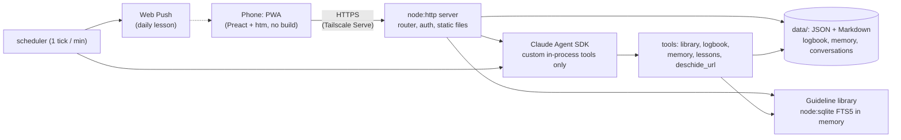

# Architecture

One Node 24 process, no framework, no build step, no database server. It serves a phone-first PWA and a small JSON API,
and runs the assistant in-process through the Claude Agent SDK.

## Server (`server/`)

| Folder | What it does |
|---|---|
| `http/` | `node:http` router with per-route body limits, the session cookie (HMAC, revocable, scrypt-hashed password), login throttle, security headers, static files from `web/`. |
| `routes/` | One module per area: `auth`, `chat` (Server-Sent Events), `registru` (logbook), `lecturi` (lessons), `ghiduri` (library), `memorie`, `uploads`, `push`, `stare`. |
| `store/` | File stores with atomic writes (temp file + rename): logbook, memory pages with history, conversations, push subscriptions. The CNP detector lives here. |
| `library/` | Reads the guideline Markdown files (with `[p. N]` page markers and a table of contents with line ranges) and builds an FTS5 index over paragraph chunks; AND first, then OR, diacritics-insensitive. |
| `lessons/` | Daily lessons cut from the guidelines: units (rows and paragraphs with ids), lessons written by the model as JSON, a strict validator, the printed lesson, and a Leitner-style spaced review of the quiz questions. |
| `llm/` | The agent (one turn in, one streamed answer out), the system prompt, the tools, the URL fetcher and the link provenance check. `fake.mjs` stands in for the model in tests and in the demo. |
| `jobs/` | Once a minute: the lesson writer (model writes, validator checks, up to three rounds), the evening reflection that updates two memory pages, the daily push notification, purges of old photos, caches, logs and SDK sessions. |

## The assistant

- The SDK runs with `settingSources: []`, no skills, no plugins and `allowedTools` limited to `WebSearch` plus the app's own
  MCP tools (`mcp__rokhan__*`). The `init` message is checked on every turn: any extra tool, plugin, skill or hook stops the turn.
- Tools are plain functions over the stores: search and read the guidelines, read and write memory pages, add, change or
  delete logbook entries, read the lesson state, and `deschide_url` (open a web page or PDF).
- The answer streams to the phone as SSE events (`status`, `delta`, `clear`, `done`). Text written before a tool call is
  narration and is cleared. The turn keeps running if the phone disconnects; the client polls until it is stored.

## The lessons pipeline

A guideline is split into units of a few pages. The model writes a lesson as JSON that references the guideline's own
rows by id (`R12`, `P3`); its own text may not contain digits or number words. Every figure the reader sees is a verbatim
slice of the guideline block it names, checked character by character, and refused when the sentence around it carries
a negation or restriction. A lesson that fails is sent back with the errors, up to three rounds.

## Frontend (`web/`)

Preact and htm as vendored ES modules, no bundler. A service worker caches the shell so the app opens offline.
Logbook entries made offline wait in an IndexedDB outbox with client-made ids, so a resend never creates a duplicate.
Three looks (Instrument, Fișă, Darkspear), each a complete set of design tokens in light and dark; a test computes the
WCAG contrast of every token pair the components use.

## Data

Everything is in one folder (`data/`, or `ROKHAN_DATA_DIR`): JSON and Markdown files, readable by the service user only.
No database to migrate, and a backup is a copy of the folder.
